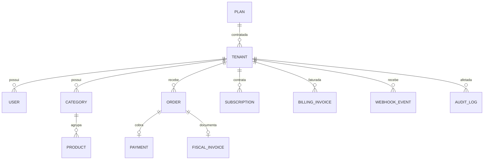

# FastLanches · plataforma multitenant

Aplicação React + TypeScript e API FastAPI assíncrona para cadastro de lojas, operação do totem, gestão da loja e administração global. O backend usa PostgreSQL 16, SQLAlchemy 2.0 e Alembic. O código foi integrado a partir das telas e dos contratos do ZIP original; o mapeamento está em [docs/CONTRATO.md](docs/CONTRATO.md).

## Estrutura

```text
.
├── src/                 React: páginas, hooks, contexts, services e tipos
├── api/
│   ├── app/             routers, services, repositories, models, schemas, adapters
│   ├── alembic/         migrations 0001–0004
│   └── tests/           isolamento, CRUD, auth, boleto, webhooks, NFC-e
├── tests/               testes dos serviços do front
├── docs/                diagnóstico e OpenAPI exportado
├── docker-compose.yml   frontend + api + db
├── Dockerfile.frontend
└── nginx.conf
```

## Executar com Docker

Requer Docker Engine/Desktop com Compose. No PowerShell:

```powershell
Copy-Item .env.example .env
```

Edite `.env`: escolha valores fortes e diferentes para `POSTGRES_PASSWORD`, `JWT_SECRET` (32 caracteres ou mais), `SUPERADMIN_PASSWORD`, `SEED_TENANT_PASSWORD` e `SEED_KIOSK_PASSWORD`. O endereço do email pode ser alterado. Depois:

```powershell
docker compose up --build
```

O Compose inicia PostgreSQL com volume e healthcheck, espera o banco, aplica `alembic upgrade head`, roda o seed idempotente e inicia a API. Acesse:

- Web: <http://localhost:5173>
- Swagger: <http://localhost:8000/docs>
- OpenAPI: <http://localhost:8000/openapi.json> ou [contrato exportado](docs/openapi.json)
- Health: <http://localhost:8000/health>

Entradas de teste configuradas no `.env`: SuperAdmin em `/superadmin/login`; gerente em `/entrar`; totem em `/totem/login`. A loja inicial é `loja-exemplo`, com uma categoria e um produto. Os logins usam os emails e as senhas que você configurou, sem credenciais embutidas no código.

## Desenvolvimento e testes

Para executar localmente, use Python 3.12, Node 22 e PostgreSQL 16. Ajuste `DATABASE_URL` para o seu banco local, instale `api/requirements.txt`, execute `alembic upgrade head` e `python -m app.seed` dentro de `api`, depois `uvicorn app.main:app --reload`. No front, execute `npm ci` e `npm run dev`. O Vite encaminha `/api` para `http://localhost:8000`; altere `VITE_API_PROXY` se necessário.

```powershell
npm test
npm run lint
npm run typecheck
npm run build
python -m pytest api/tests -q
```

Os três testes de front exercitam o contrato dos serviços de login, criação de cliente e emissão de boleto. Os testes Python usam SQLite assíncrono para verificar as regras da API; a execução real em PostgreSQL deve ser validada pelo Compose no ambiente de implantação.

## Variáveis principais

| Variável | Uso |
|---|---|
| `POSTGRES_PASSWORD`, `DATABASE_URL` | Banco de dados; no Compose a URL usa o serviço `db` |
| `JWT_SECRET` | Assinatura dos tokens; obrigatório e forte em produção |
| `SUPERADMIN_EMAIL`, `SUPERADMIN_PASSWORD` | Criação do usuário global no seed |
| `SEED_TENANT_EMAIL`, `SEED_TENANT_PASSWORD` | Gerente da loja de exemplo |
| `SEED_KIOSK_EMAIL`, `SEED_KIOSK_PASSWORD` | Usuário do totem de exemplo |
| `PAYMENT_PROVIDER` | `mock`, `mercadopago` ou `abacatepay` |
| `MERCADO_PAGO_ACCESS_TOKEN`, `MERCADO_PAGO_WEBHOOK_SECRET` | Pagamentos e validação de webhook Mercado Pago |
| `ABACATEPAY_API_KEY`, `ABACATEPAY_WEBHOOK_SECRET`, `ABACATEPAY_PUBLIC_KEY` | Pagamentos e assinatura AbacatePay |
| `PAYMENT_GUEST_EMAIL` | Email substituto para Pix sem email do consumidor no Mercado Pago |
| `INVOICE_PROVIDER`, `NOTAAS_API_KEY`, `NOTAAS_WEBHOOK_SECRET` | `mock` ou `notaas` e credenciais fiscais |
| `FISCAL_KEY_ENCRYPTION_KEY` | Chave Fernet para guardar chave Notaas específica de cada loja |
| `SMTP_HOST`, `SMTP_PORT`, `SMTP_USER`, `SMTP_PASSWORD`, `SMTP_FROM`, `SMTP_STARTTLS` | Envio de email; sem SMTP em desenvolvimento, o conteúdo aparece nos logs da API |
| `CORS_ORIGINS`, `FRONTEND_BASE_URL`, `PUBLIC_BASE_URL`, `VITE_API_URL` | Origens, links públicos e URL da API |
| `ENVIRONMENT` | `development` habilita provedores mock; `production` exige segredos e provedores reais |

Para gerar uma chave Fernet: `python -c "from cryptography.fernet import Fernet; print(Fernet.generate_key().decode())"`. Não inclua `.env` no Git nem no pacote distribuído.

## API e permissões

Todas as rotas de negócio têm prefixo `/api/v1`. A API também expõe `/admin/*` como alias para integração direta; o front usa `/api/v1/admin/*`. O SuperAdmin global acessa essas rotas com JWT de papel `superadmin`. Gerentes só acessam o próprio tenant, e usuários de totem só executam operações de compra. Nas rotas normais, `tenant_id` é obtido do JWT e aplicado nas consultas; somente rotas SuperAdmin aceitam o tenant alvo explicitamente.

| Área | Rotas principais |
|---|---|
| Autenticação | `POST /auth/login`, `/auth/refresh`, `/auth/logout`, `/auth/forgot-password`, `/auth/reset-password`; `GET /auth/me` |
| Público | `GET /plans`, `POST /tenants`, `POST /contact` |
| Loja | CRUD `/categories`, `/products`; `/orders`, `/payments/pix`, `/payments/{order_id}/status`, `/fiscal-invoices`, `/reports/summary` |
| SuperAdmin | `/admin/tenants`, `/admin/plans`, `/admin/invoices`, `/admin/settings`, `/admin/reports/export/*`, `/admin/audit` |
| Webhooks | `POST /webhooks/mercadopago`, `/webhooks/abacatepay`, `/webhooks/notaas` |

Access token fica somente em memória no navegador; refresh token é rotativo e fica em cookie HttpOnly. A senha usa Argon2. O front não mantém dados de negócio em localStorage.

## Entidades



Todas as chaves primárias são UUID. Planos, configurações globais e SuperAdmin são globais; `ContactMessage` pode não ter tenant porque o formulário é público. Tabelas de loja e cobrança possuem `tenant_id` e índices compostos nas consultas frequentes.

## Provedores e limites

- Pix e boleto são criados pelo adapter `PaymentProvider`. Mercado Pago usa [Payments API](https://www.mercadopago.com.br/developers/pt/docs/checkout-api-payments/integration-configuration/other-payment-methods); AbacatePay usa [Transparent Payments v2](https://raw.githubusercontent.com/AbacatePay/documentation/main/openapi.yaml). O adapter AbacatePay não oferece cancelamento remoto porque a API consultada não documenta essa operação; a tentativa retorna 501. O PDF local do boleto é um comprovante de instruções com link/linha digitável, enquanto o boleto oficial está em `boletoUrl` quando fornecido pelo provedor.
- Após pagamento Pix confirmado, o adapter `InvoiceProvider` solicita NFC-e modelo 65 pela [API Notaas](https://docs.notaas.com.br/docs/nfe/endpoints), se a loja habilitou a integração. NCM e CFOP devem estar em todos os produtos; o SuperAdmin configura a chave por loja, criptografada no banco. Status, número e URLs ficam em `fiscal_invoices`; o gerente pode consultar, tentar de novo e baixar o DANFE.
- Webhooks exigem assinatura e são idempotentes. O modo `mock` permite simular a confirmação de Pix no painel de pedidos, somente em desenvolvimento.
- A assinatura criada no checkout inicia 14 dias de teste. A emissão do boleto da assinatura é uma ação do SuperAdmin; não há cobrança automática no fim do teste. Regras de atraso e suspensão rodam periodicamente.
- O modo `mock` não representa pagamento nem NFC-e válidos. Para homologação real, configure contas sandbox/credenciais dos provedores e SMTP.

## Histórico por fase

- **A:** esquema UUID multitenant, Alembic, Compose, seed e API em camadas.
- **B:** login, refresh, recuperação de senha e proteção de rotas React.
- **C:** CRUD SuperAdmin, configurações, auditoria e CSV.
- **D:** boleto, adapters de pagamento, webhooks, idempotência e email.
- **E:** cardápio, pedidos, Pix, cozinha, cadastro e contato com API real.
- **F:** NFC-e Notaas, status no painel e testes de isolamento fiscal.
